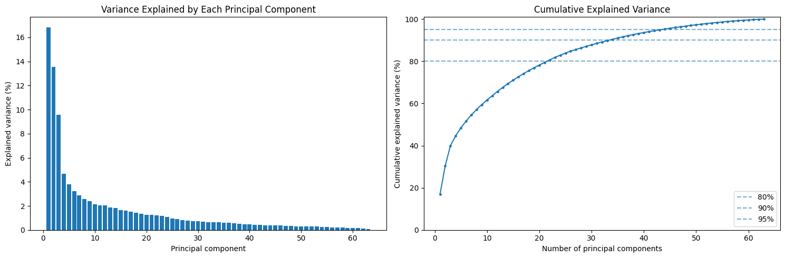
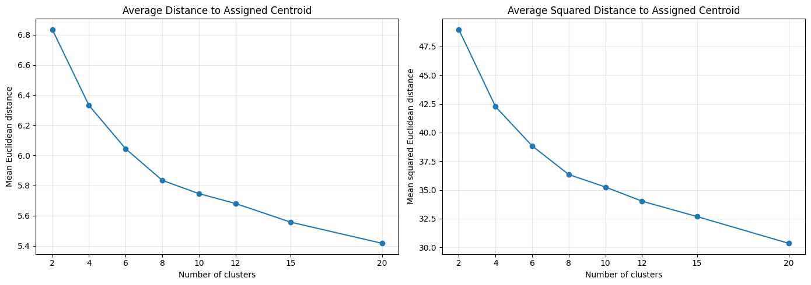
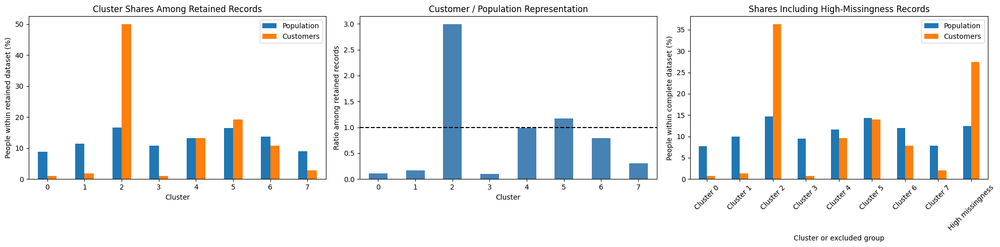

# Arvato Customer Segmentation

An unsupervised learning project completed as part of Udacity's **Introduction to Machine Learning with PyTorch** Nanodegree, within my MSc in Artificial Intelligence studies.

**Project status:** passed Udacity review in November 2026.

This repository preserves my submitted analysis and explanations, including the exploratory work and the decisions I made while learning. For public sharing, saved previews of individual demographic records and copied data-dictionary outputs have been removed. Code and Markdown cells are unchanged from the submitted notebook.

## The question

Which demographic segments are more prevalent among a German mail-order company's customers than in the general population?

I learned clusters from the general-population data, then applied the same cleaning rules, fitted imputer, scaler, PCA, and k-means model to the customer data. This lets both datasets be compared using the same segments.

## Project files

| File or folder | Contents |
| --- | --- |
| [Identify_Customer_Segments.ipynb](Identify_Customer_Segments.ipynb) | Submitted notebook, with selected saved outputs removed for public sharing |
| [reports/Identify_Customer_Segments.html](reports/Identify_Customer_Segments.html) | HTML export of the public notebook |
| [assets/](assets/) | Three original aggregate plots extracted from notebook outputs |
| [requirements.txt](requirements.txt) | Packages needed to work with the notebook |
| [.gitignore](.gitignore) | Excludes project datasets, reference files, environments, and model artifacts |
| [PORTFOLIO.md](PORTFOLIO.md) | Suggested portfolio entry |

GitHub displays the notebook directly. To read the HTML report, download it and open it in a browser; GitHub's file viewer does not render it as a webpage.

## Data and preparation

The input files contained **891,221 population records** and **191,652 customer records**, each with 85 demographic features. Features describe people as well as their households, buildings, and surrounding areas. These records should not be interpreted as a verified census of Germany.

My preprocessing steps were:

1. Convert documented missing and unknown codes to `NaN`.
2. Remove six features with more than 30% missing values, using the observed gap in column missingness to justify the threshold.
3. Retain records with at most 10 missing values across the remaining 79 original features, while tracking excluded records separately.
4. Compare five complete features between the low- and high-missingness groups.
5. Encode the binary east/west feature and remove 13 multi-level categorical features, as permitted by the project instructions.
6. Engineer formative decade and movement from `PRAEGENDE_JUGENDJAHRE`, and wealth and life stage from `CAMEO_INTL_2015`.
7. Remove the original mixed features and `GREEN_AVANTGARDE`, which duplicated the engineered movement feature after imputation.
8. Impute remaining missing values using each feature's most frequent value and standardize features with `StandardScaler`.

The final modeling data included **780,153 population records**, **139,068 customer records**, and **63 numeric features**. The cleaning function reproduced the step-by-step preparation.

## PCA and clustering

PCA reduced the 63 features to **34 components**, retaining **90.43%** of the standardized population variance. I examined the first three components and used the data dictionary to interpret their residential/economic, age/generation, and gender-associated classification patterns.



I compared k-means models with **2, 4, 6, 8, 10, 12, 15, and 20 clusters** on the same random sample of 100,000 retained population records. I selected **8 clusters** based on diminishing distance improvements around 6–8 clusters, then fitted the final model on all retained population records. The sample comparisons and final fit used `random_state=42` and `n_init=10`.



## Main findings

| Segment | Share of retained population | Share of retained customers | Customer/population representation ratio |
| --- | ---: | ---: | ---: |
| Cluster 2 | 16.71% | 50.04% | 2.99 |
| Cluster 3 | 10.80% | 1.10% | 0.10 |

Cluster 2 was strongly overrepresented among customers. Population members assigned to this cluster were predominantly male-coded and estimated to be aged 46 or older, with higher income and affluence, stronger saving/investing affinities, and a tendency toward smaller, less dense communities compared with the retained population.

Cluster 3 was strongly underrepresented. Its population members were predominantly female-coded and younger, with lower income and affluence, weaker saving/investing affinities, and a tendency toward denser areas and larger communities.

These descriptions summarize provider classifications within this particular dataset; they are not universal demographic characteristics. Cluster numbers are arbitrary identifiers.



## What I learned and limitations

- The direction of a code matters. Higher financial-affinity codes mean weaker affinity; higher income and CAMEO wealth codes mean lower income or affluence.
- Two differently named features can duplicate the same information. I identified that overlap, removed one feature, and reran the downstream analysis.
- Data exclusion changes the population being described: **12.46% of population records** and **27.44% of customer records** were excluded for high missingness. They are shown separately in the final comparison.
- Denominators affect interpretation. Cluster 5 was moderately overrepresented among retained records, but not when all records were included in the denominators.
- Dropping multi-level categorical features loses information, and most-frequent imputation can alter distributions and relationships.
- Treating ordinal features as equally spaced is a project modeling assumption. Scaling, feature selection, PCA retention, and k-means choices all affect the segments.
- A representation ratio describes relative dataset shares, not individual purchase probabilities, causal effects, or campaign profitability. Campaign response would need separate evaluation.
- The elbow comparison used a population sample, and eight clusters is a justified practical choice rather than evidence of eight uniquely natural groups.

## Viewing and running

The saved aggregate notebook outputs and HTML report can be read **without access to the source datasets**.

To execute the analysis, you need authorized access to the original project files. The repository does not provide or download them:

- `Udacity_AZDIAS_Subset.csv`
- `Udacity_CUSTOMERS_Subset.csv`
- `AZDIAS_Feature_Summary.csv`
- `Data_Dictionary.md`

Place authorized local copies in the repository root, alongside the notebook, because the original notebook uses relative filenames. These files are excluded by `.gitignore`.

The submitted notebook recorded **Python 3.10.13**. Exact dependency versions from the original environment were not captured; `requirements.txt` is a package list, not a reproducibility lockfile.

```bash
python3 -m venv .venv
source .venv/bin/activate
python -m pip install -r requirements.txt
jupyter notebook Identify_Customer_Segments.ipynb
```

The full analysis is memory- and compute-intensive. To export a report after an authorized local run:

```bash
jupyter nbconvert --to html Identify_Customer_Segments.ipynb --output-dir reports
```

Running the unchanged preview cells recreates individual-record and reference-document outputs. Remove those outputs again before sharing any locally rerun notebook or report publicly.

## Data access and acknowledgments

The datasets were provided through Udacity by Bertelsmann partners AZ Direct and Arvato Financial Solutions. The notebook framework and assignment instructions were supplied by Udacity; the implementation, analysis, and discussions were completed by Massimiliano Sermi.

The source data and supplied reference documents are proprietary and are not distributed here. The project terms restrict dataset use to the educational project and require downloaded data to be deleted within two weeks of completing it. No data downloads or trained model files are included in this repository.
